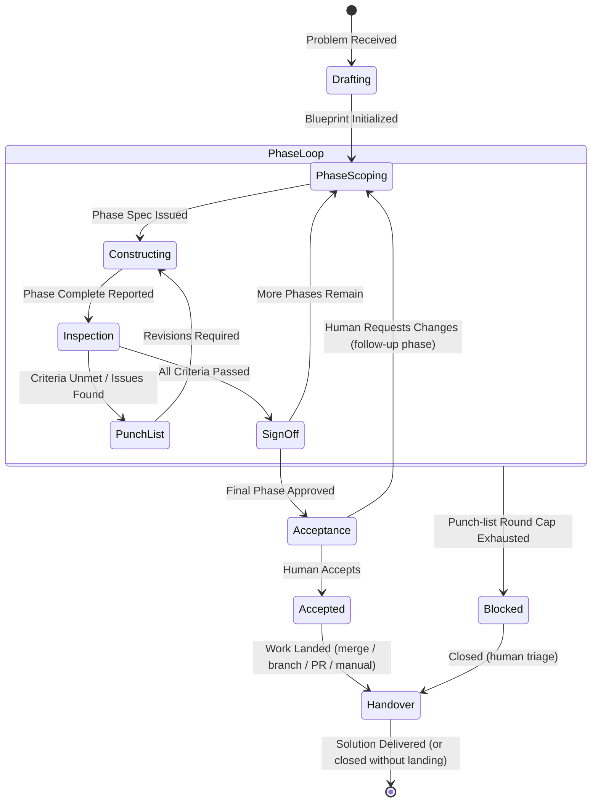

# Blueprint Protocol: Multi-Model Collaborative Problem Solving

> **Specification & Agent Guidance**  
> A dual-model operational pattern: a high-agency **Architect & Builder** stage-gate review loop.

---

## 1. Overview & Core Philosophy

The **Blueprint** pattern coordinates two models to solve complex, multi-step problems through structured, iterative phases:

* **Separation of Concerns:** The **Architect** focuses on macro strategy, decomposition, and quality inspection. The **Builder** focuses on deep, tactical implementation.
* **Continuous Stage-Gate Verification:** Instead of one-shot waterfall planning, execution is broken into bite-sized phases. Each phase requires formal inspection and sign-off before the next begins.
* **Peer Professionalism:** Neither model is superior or subservient. Both are senior specialists with complementary domains: systems design & quality assurance vs. hands-on execution.

---

## 2. Roles & Responsibilities

### The Architect (Model A)

* **Decomposition:** Breaks complex tasks down into clear, sequential milestones.
* **Phase Scoping:** Generates precise, self-contained specifications for the active phase only (preventing context bloat for the Builder).
* **Inspection:** Rigorously reviews the Builder's output against the phase acceptance criteria.
* **Punch Lists:** Issues structured, actionable feedback when deliverables fail acceptance criteria.
* **Sign-Off:** Formally approves verified stages and advances the blueprint.

### The Builder (Model B)

* **Execution:** Implements the solution for the active phase spec.
* **Deliverable Reporting:** Presents completed work with verification evidence (test outputs, logs, diffs, or reasoning) via `blueprint_submit`. Builders never inspect or sign off their own work (do not call `blueprint_inspect`; inspection is exclusively the Architect's role).
* **Remediation:** Resolves items on the Architect's Punch List efficiently without scope creep.
* **Discipline:** Does not attempt future phases until the current phase receives formal sign-off.

---

## 3. The Lifecycle State Machine



---

## 4. Lifecycle Stages & Terminology

| Stage / Term | Actor | Description |
| :--- | :--- | :--- |
| **`Drafting`** | Architect | Analyzes the problem space, dependencies, and drafts the overall milestone roadmap. |
| **`Phase Spec`** | Architect | Dispatches the exact requirements, constraints, and acceptance criteria for Phase $N$. |
| **`Constructing`** | Builder | Executes the work for Phase $N$. Produces artifacts, code, or reasoning. |
| **`Deliverable`** | Builder | Submits the completed stage deliverables accompanied by verification proof. |
| **`Inspection`** | Architect | Reviews deliverables against acceptance criteria. |
| **`Punch List`** | Architect | *If issues exist:* Enumerates specific defects or missing requirements to resolve. |
| **`Sign-Off`** | Architect | *If passing:* Formally clears Phase $N$ and records progress in the ledger. |
| **`Acceptance`** | Human | Reviews the finished work (in the series worktree, if any): accepts it, or describes what needs fixing, which becomes a follow-up phase. |
| **`Landing`** | Architect | Lands accepted work the way the human chose: merge into the main checkout, push a branch, or open a pull request; or records that the human will land it themselves (`manual`, which keeps the worktree and branch). |
| **`Handover`** | Architect | Concludes the Blueprint run once the work has landed (or the run is closed without landing). |

---

## 5. Message Protocols & Schemas

### A. Architect: Phase Spec Template

```markdown
### [BLUEPRINT] Phase Spec: Phase <Number> - <Phase Title>

#### Objective
<1-2 sentences on what this phase accomplishes.>

#### Scope & Requirements
- [ ] Requirement 1
- [ ] Requirement 2

#### Verification & Acceptance Criteria
- <Specific check, test command, or output condition required for sign-off>

#### Context & Constraints
<Any relevant dependencies, schemas, or restrictions the Builder must follow.>
```

---

### B. Builder: Deliverable Template

````markdown
### [BLUEPRINT] Deliverable: Phase <Number> - <Phase Title>

#### Completed Items
- [x] Item 1: <Summary of changes/solution>
- [x] Item 2: <Summary of changes/solution>

#### Verification Proof
```bash
<Test outputs, command executions, or demonstration of correctness>
```

#### Notes / Edge Cases Handled

<Key design decisions, observed caveats, or notes for the Architect.>

*Ready for inspection.*
````

---

### C. Architect: Inspection Response Templates

#### Option 1: Punch List (Revisions Needed)

```markdown
### [BLUEPRINT] Inspection: Phase <Number> - Punch List Issued

#### Findings
The phase deliverable does not yet meet acceptance criteria:
1. **Issue 1:** <Description of gap or bug>
   - *Required Fix:* <Clear remediation instruction>
2. **Issue 2:** <Description of gap or bug>
   - *Required Fix:* <Clear remediation instruction>

*Builder: Address these punch list items and re-submit for inspection.*
```

#### Option 2: Phase Sign-Off (Passed)

```markdown
### [BLUEPRINT] Inspection: Phase <Number> - SIGN-OFF GRANTED

#### Verdict
All acceptance criteria verified and passed.

#### Ledger Update
- Phase <Number> (<Phase Title>): COMPLETED

---
*Proceeding to next phase spec...*
```

---

## 6. Rules of Engagement

1. **One Phase at a Time:** The Builder must never speculate or execute work for Phase $N+1$ while Phase $N$ is active.
2. **Evidence Before Sign-Off:** The Architect must never grant Sign-Off based on assumptions; every sign-off requires tangible evidence or verified outputs in the Builder's report.
3. **No Role Drift:**
   * The Architect provides design, constraints, and critiques; it does not write the implementation code.
   * The Builder provides solutions and execution; it does not redesign the master blueprint without flagging a blocker to the Architect.
4. **Actionable Punch Lists:** Every punch list item must point to an explicit requirement from the Phase Spec.
5. **Zero-Token Phase Handoffs:** With Breakroom hooks installed, do not call `wait_for_message` across phase boundaries.
   * After `blueprint_spec`, the Architect ends their turn immediately without calling `wait_for_message`. The Breakroom stop gate holds the Architect at zero tokens until the Builder submits the deliverable.
   * After `blueprint_submit`, the Builder ends their turn immediately without calling `wait_for_message`. The Breakroom stop gate holds the Builder at zero tokens until the next phase spec, punch list, or handover arrives.
   * On hosts without hooks there is no stop gate: call `wait_for_message` instead of ending the turn.
